# ClassGame

**For judges with little time:** no local setup is needed. Start with the hosted **Google Cloud production build**.

| Start here | Link | What to verify |
|---|---|---|
| **3:53 demo video** | [Watch the full loop](https://www.youtube.com/watch?v=mvsbSKlGfyE) | Teacher creates a mission, student plays, Mia adapts, dashboard receives evidence. |
| **Teacher dashboard** | [Open on GCP Cloud Run](https://classgame-web-2057331207.us-east1.run.app/dashboard) | Use the Devpost credentials, generate or inspect a mission, then open student evidence. |
| **Student game** | [Open with class code `367501`](https://classgame-web-2057331207.us-east1.run.app/home?classCode=367501) | Enter any name, start the mission, answer wrong once, see Mia ask *why*. |
| **API health** | [Open production API](https://classgame-api-2057331207.us-east1.run.app/) | Cloud Run API is live with Firebase and Redis health checks. |

**ClassGame is the optional homework that takes notes for the teacher.**

ClassGame is submitted as a production app hosted on **Google Cloud Platform**: the 3D student game and teacher dashboard run on **Cloud Run**, the Go API runs on **Cloud Run**, durable state lives in **Firestore**, attachments are copied into **Cloud Storage**, learning jobs run through **Cloud Tasks**, Gemini calls go through **Vertex AI**, secrets live in **Secret Manager**, and deployment is handled by **Cloud Build**, **Artifact Registry** and **Cloud Logging**.

A teacher types what the class covered today (and optionally attaches the worksheet). **Mia**, the **Multimodal Intelligence Agent** powered by Gemini on Vertex AI, turns it into a short 3D review mission. Students play it on their phones for ten minutes: Mia leads them question by question, asks *why* they picked a wrong answer, explains in the style that works for that student, and keeps a memory of each student that survives the tab, the session and the mission. The teacher opens the class page and sees — live — where every student is, what Mia observed, which patterns repeat across the class, and what to teach tomorrow.

Built for the **All Things Agentic Hackathon**, category **The Collaborative Partner — in depth**.

> **The focus:** stateful, multi-turn dialogue with real-time context retrieval (RAG) and persistent memory, so your agent adapts and personalizes based on past interactions instead of starting over each time.
>
> **Example:** an expert guide that helps you understand a dense document, quizzes you as you go, learns which concepts you struggle with, and adapts future explanations.

ClassGame is that example, with a classroom around it: the "dense document" is the teacher's lesson and worksheet, the quiz is the mission, the concepts you struggle with are named misconceptions, and the adaptation is visible on the chalkboard and in the teacher's dashboard.

## Judge Fast Path

If you have only a few minutes, verify this path in the hosted GCP build:

1. Open the **[teacher dashboard](https://classgame-web-2057331207.us-east1.run.app/dashboard)** and sign in with the Devpost credentials.
2. Open the **[student game with class code `367501`](https://classgame-web-2057331207.us-east1.run.app/home?classCode=367501)**, enter any name, choose the mission and press **Start**.
3. Answer one question incorrectly; Mia asks *why*, retrieves the relevant lesson chunks, adapts the explanation, and records a teacher-only observation.
4. Close and reopen the student tab; the exact checkpoint restores from Firestore.
5. Finish the mission; Cloud Tasks finalizes the learning trace and class synthesis.
6. Return to the dashboard; Firestore realtime updates show live progress, RAG provenance, student memory and the next-lesson prompt.

## Explore ClassGame

| Experience | Link |
|---|---|
| 🎮 **Student game on GCP Cloud Run** | [Enter the 3D classroom with class code `367501`](https://classgame-web-2057331207.us-east1.run.app/home?classCode=367501) |
| 🧑‍🏫 **Teacher dashboard on GCP Cloud Run** | [Create and monitor missions](https://classgame-web-2057331207.us-east1.run.app/dashboard) |
| ⚙️ **API on GCP Cloud Run** | [Open the production API](https://classgame-api-2057331207.us-east1.run.app/) |
| 🎬 **Demo video** | [Watch on YouTube](https://www.youtube.com/watch?v=mvsbSKlGfyE) |
| 💬 **Build story** | [Read the LinkedIn post](https://www.linkedin.com/posts/velrino_allthingsagentichackathon-ugcPost-7499787792177262593-g9Mz) |
| 🏆 **Hackathon** | [All Things Agentic on Devpost](https://allthingsagentichackathon.devpost.com/) |
| 🧪 **Reproduce it** | [Follow the setup and testing instructions](#reproducible-setup-and-testing) |

## GCP production footprint

ClassGame is not a mockup around screenshots. The submitted app is a deployed Google Cloud system:

| Layer | Production service |
|---|---|
| Student game and teacher dashboard | GCP Cloud Run service for `apps/web` |
| Backend API and agent orchestration | GCP Cloud Run service for `apps/api` |
| Gemini mission generation, tutor turns and learning synthesis | GCP Vertex AI through the Google GenAI SDK |
| Durable classroom, mission, attempt, memory and summary state | Firestore |
| Worksheet attachment copies | GCP Cloud Storage |
| Async attachment copy, completion trace and abandonment watchdog | GCP Cloud Tasks |
| Runtime secrets | GCP Secret Manager |
| Distributed GenAI quotas and health gates | Redis, configured from Secret Manager |
| Production build and rollout | GCP Cloud Build, Artifact Registry, Cloud Logging |

<p align="center">
  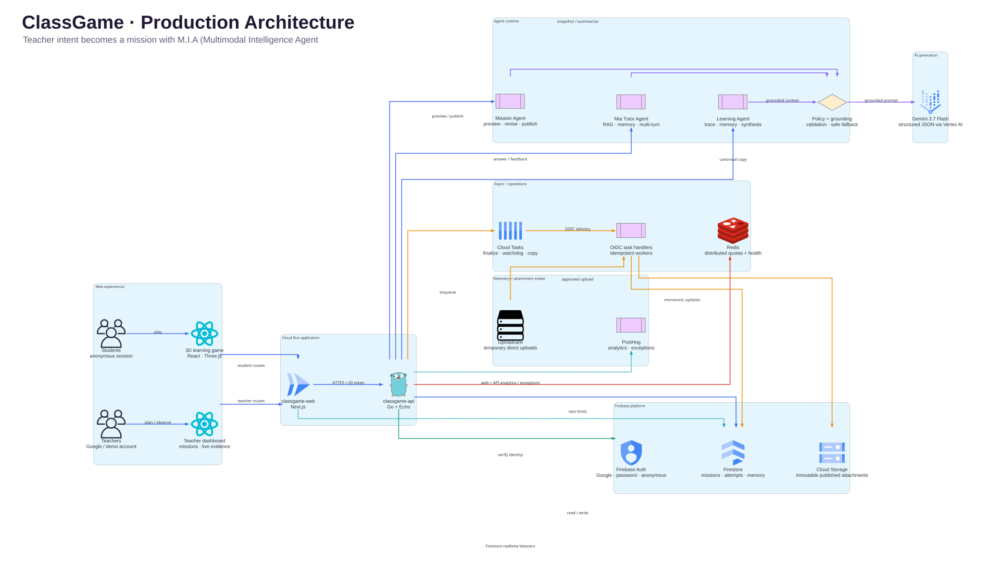
</p>

## Product tour

Every screen below is from the working product. Select any image to open it at full resolution.

| Student experience | Teacher experience |
|:---:|:---:|
| **Join a class in seconds**<br><a href="assets/pitch/01-0.png">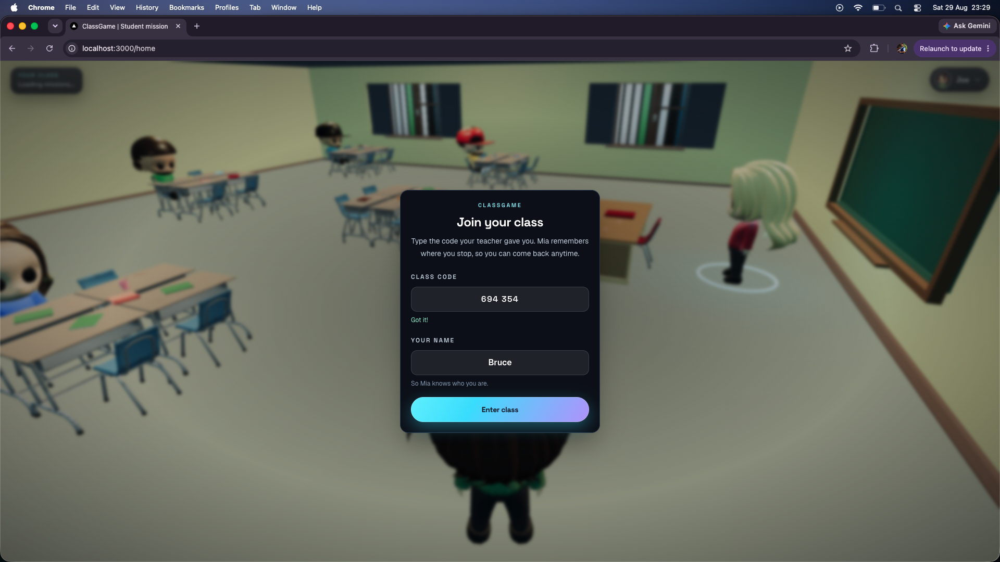</a> | **Student and teacher experiences, side by side**<br><a href="assets/pitch/01-1.png">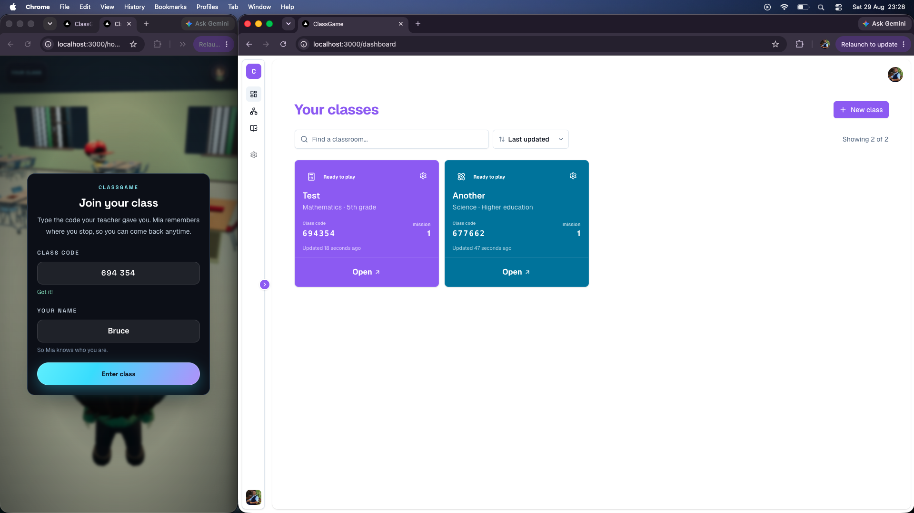</a> |
| **Explore the 3D classroom**<br><a href="assets/pitch/01-2.png">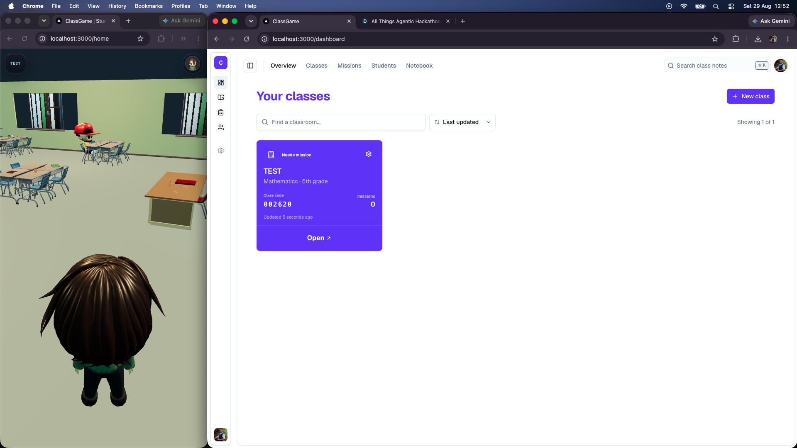</a> | **Create a mission with Mia**<br><a href="assets/pitch/02-1.png">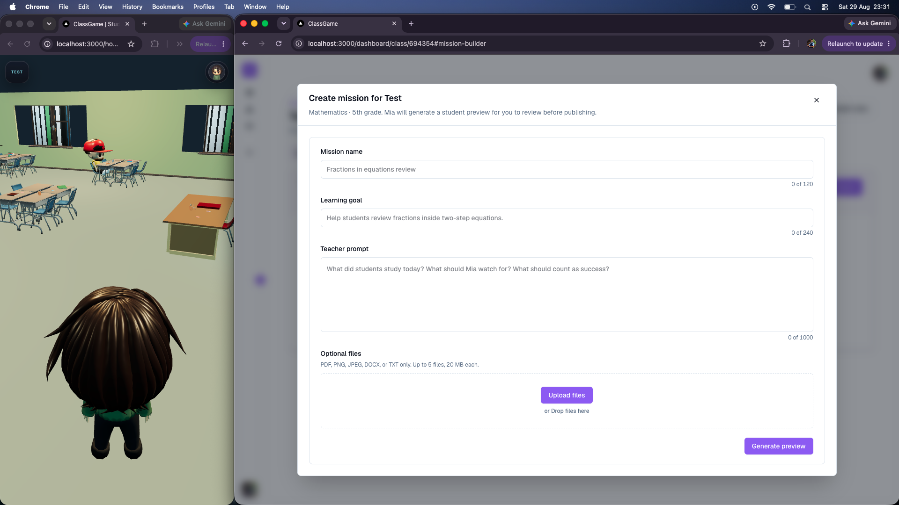</a> |
| **Ground missions in real worksheets**<br><a href="assets/pitch/02-2.png">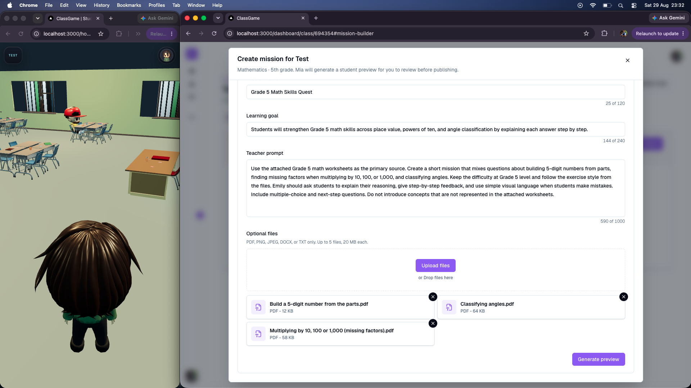</a> | **Review and refine AI-generated questions**<br><a href="assets/pitch/02-3.png">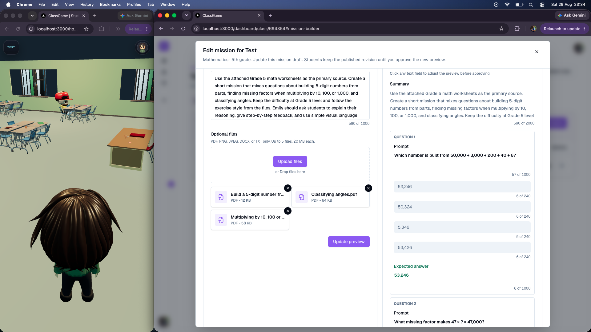</a> |
| **Inspect the mission flow**<br><a href="assets/pitch/02-4.png">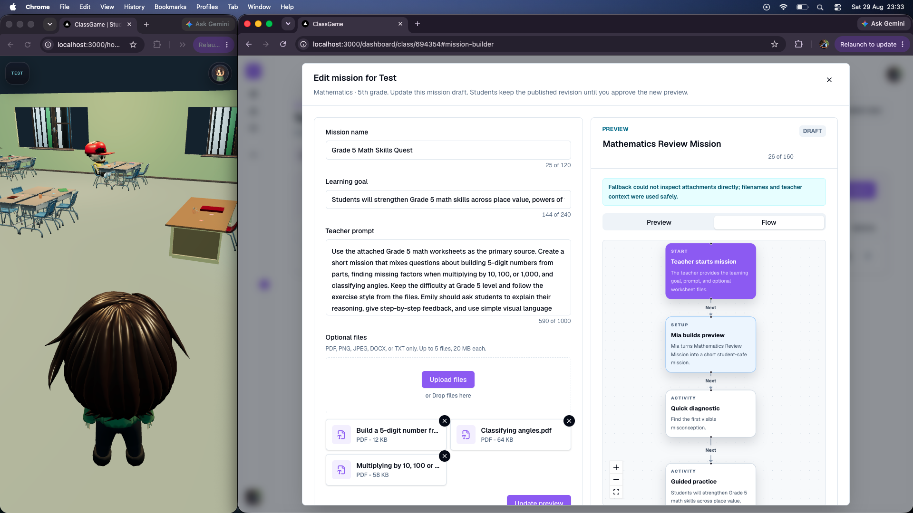</a> | **Publish the mission to the class**<br><a href="assets/pitch/03-1.png">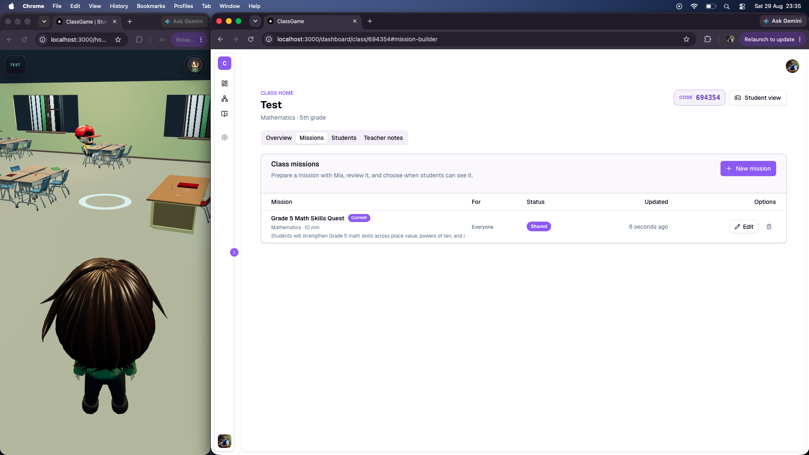</a> |
| **Choose a mission from the classroom**<br><a href="assets/pitch/03-2.png">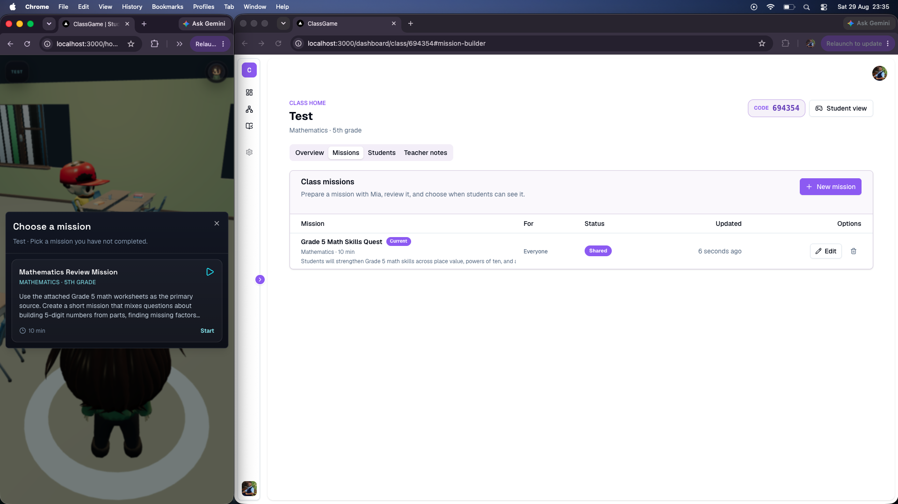</a> | **Follow live, grounded tutor turns**<br><a href="assets/pitch/03-3.png">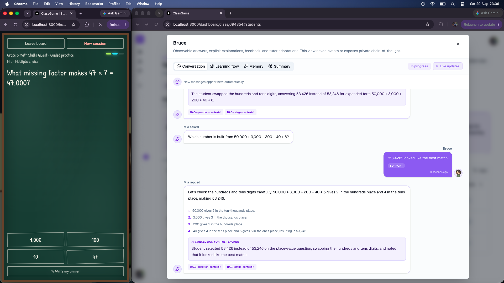</a> |
| **See the evidence-backed learning flow**<br><a href="assets/pitch/03-4.png">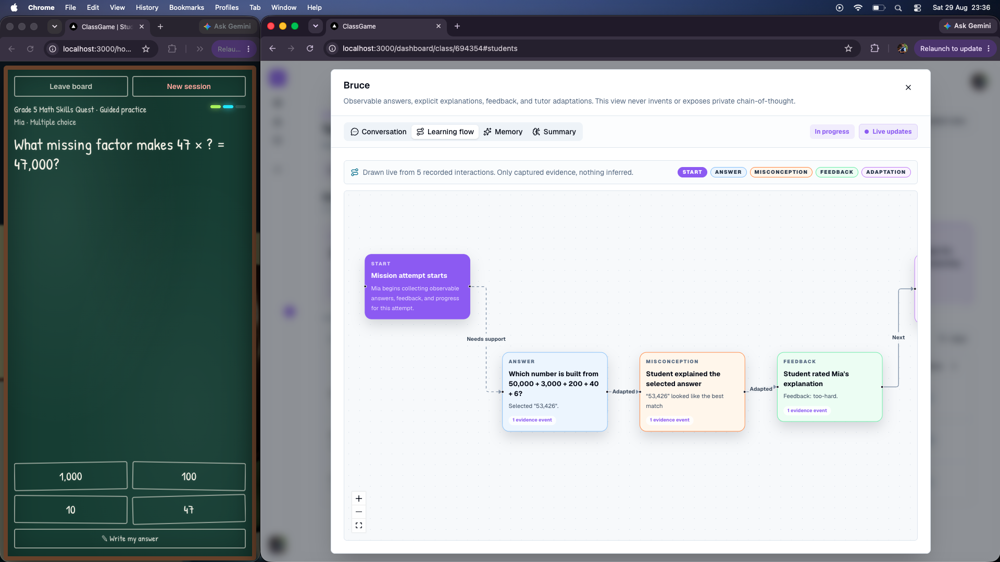</a> | **Turn the completed mission into insight**<br><a href="assets/pitch/03-5.png">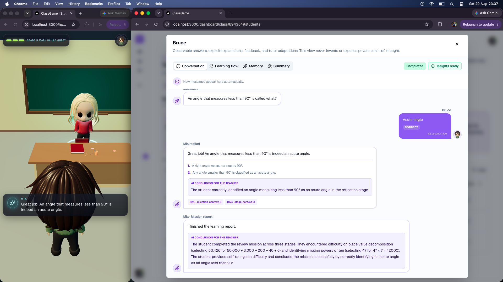</a> |
| **Understand the whole class at a glance**<br><a href="assets/pitch/04-1.png">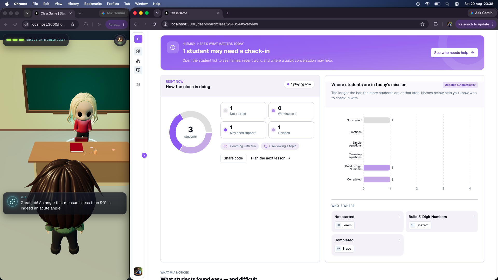</a> | **Inspect the production architecture in-app**<br><a href="assets/pitch/05-1.png">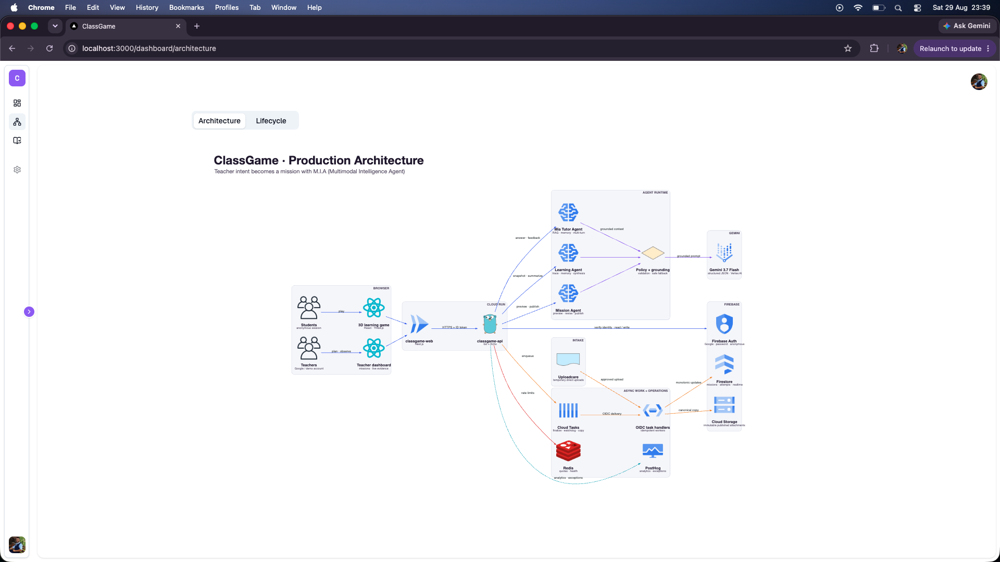</a> |

---

## Why this shape

Homework tells you *who* got it wrong, never *why*. And most tutoring apps talk only to the student — the teacher never hears back. ClassGame puts the teacher at both ends of the loop and the agent's memory in the middle:

```txt
Teacher                            Mia (agent)                           Student
──────────                       ─────────────                          ───────
"Today: two-step equations.      generates the mission                  plays 10 min on a phone
 Several slipped on fractions."  (questions, traps, knowledge chunks)   → answers → "why?" → feedback
 + worksheet PDF                 ───────────────────────────────────►   → Mia adapts, turn by turn
                                 remembers each student
                                 (attempt, checkpoint, memory)          closes the tab, comes back
                                 writes a learning trace                → resumes at the exact step
 reads the class page live       ◄───────────────────────────────────
 "7 students add fractions       clusters the class
  straight across."              "next adaptation: ..."
 "Build tomorrow's mission"
```

Two people collaborate with Mia. The **student** gets a tutor who never starts over. The **teacher** gets an assistant who plans from evidence instead of guesses.

## Collaborative Partner alignment

| Brief | Where it lives in the product | Code |
|---|---|---|
| **Stateful, multi-turn dialogue** | Every answer, explicit "why" and feedback tap is one Gemini turn on the same attempt. Each turn receives the last 24 observable events and the last 12 tutor turns of that attempt, so "you marked *confusing* two questions ago" is real context, not a canned line. The teacher's loop is multi-turn too: prompt → preview → revise → approve, all on one mission document with numbered revisions. | `api/internal/modules/users/service.go` (`SaveStudentTutorTurn`), `api/internal/modules/mission` |
| **Real-time context retrieval (RAG)** | At mission generation Gemini distils the teacher prompt and attachments into 3–12 **knowledge chunks** stored in the published revision. On every student turn the API retrieves the top 5 chunks for *this* question and *this* student response, plus the student's memory, the attempt history and the class-level patterns, and puts them in the prompt. The chunk ids Gemini actually used are stored with the turn and shown to the teacher as `RAG · chunk-id` chips. | `retrieveMissionKnowledge`, `orchestrator.BuildTutorTurn` |
| **Persistent memory** | Three layers in Firestore: the **attempt** (`student_mission_attempts`: progress, notes, decisions, events, exact checkpoint, tutor turns, trace), the **student** (`users/{uid}.student.learning_memory`: strengths, improvement areas, preferred explanation, *next adaptation* — carried into the next mission), and the **class** (`class_learning_summaries/{class_id}`: clustered strengths and needs across students). | `api/internal/modules/users/repository.go` |
| **Adapts from past interactions** | Explanation style (steps ↔ visual), difficulty bias and the next action change from feedback and repeated slips, and Mia says why. A returning student is put back at the exact question, phase and step. When a mission ends (or is abandoned), Gemini writes a learning trace whose `next_adaptation` tells the *next* turn what to retrieve and how to adapt. The teacher's "Build tomorrow's mission" button turns the class patterns into the next prompt. | `session-reducer.ts` (`restoreLesson`, `apply-tutor-turn`), `finalizeStudentAttempt` |

## The core loop (this is the product)

```txt
1. Mia writes a question on the board                         ← leads
2. Student answers
3. Wrong? Mia asks "Why did you pick that?"                   ← clarifying question (why_prompt from Gemini)
4. Student picks a reason written in their voice, or types one
5. API grounds the turn, retrieves chunks + memory, calls Gemini
6. Mia explains in short steps or with a drawing              ← adapts style
7. Student taps helpful / confusing / too easy / too hard     ← feedback
8. Mia decides the next step and says why                     ← "You marked 'confusing' → I'll draw the next one."
   Teacher-only: a one-line observation + the chunk ids used  ← notes (never shown to the student)
→ back to 1, until the mission is complete
→ close the tab: the checkpoint is saved; reopen: "Welcome back — last time you were on Fractions."
→ mission complete or abandoned: Gemini writes the learning trace; the class summary is re-clustered
```

## One tutor turn, in depth

This is the part the category is about, so here is exactly what happens when a student taps an answer (`POST /users/student-tutor-turn`):

1. **The game dispatches locally first** — the chalkboard moves on instantly with a deterministic tutor (`web/src/modules/game/agent/mock-tutor.ts`), so the lesson never waits on the network. The API turn then overwrites Mia's message, the "why" prompt, the explanation steps and the style/difficulty preferences when it lands. If Gemini is offline the deterministic copy simply stays.
2. **Grounding** — the server ignores the client's idea of the question. It loads the pinned published revision of the mission and overwrites `prompt`, `expected_answer` and `stage_id` from the real question; correctness is decided server-side. Unknown `question_id` → 400.
3. **Retrieval** (`retrieveMissionKnowledge`) — a query is built from subject + learning goal + stage + question prompt + the student's response + their explicit reasoning, and scored against every `knowledge_chunk` of the published revision (title, content, keywords) by token overlap, with a boost when the chunk belongs to the current stage. Top 5 go into the prompt. This is lexical retrieval over model-distilled chunks — no vector store — which is deliberate: every chunk is traceable to the teacher's material and the teacher can read exactly what was retrieved.
4. **Memory** — from `users/{uid}`: `learning_memory` (strengths, improvement areas, preferred explanation, next adaptation from the previous mission). From `student_mission_attempts/{attempt_id}`: progress per stage, the last 24 observable events, the last 12 tutor turns. From the class: the four most frequent strengths and needs across the latest finalized attempts of every classmate (`class_context`).
5. **Gemini** (`orchestrator.BuildTutorTurn`, structured output, temperature 0.25) returns: `message`, `why_prompt`, `explanation_steps` (≤6), `explanation_style` (`steps|visual`), `difficulty_bias` (−1..1), `next_action` (`continue|ask_reasoning|explain|retry|complete`), `teacher_observation`, `retrieved_chunk_ids`, `evidence_event_ids`. The system instruction forbids revealing teacher-only memory, class patterns or other students, forbids claiming to read hidden chain-of-thought, and only allows adaptation — never labelling, ranking or grading.
6. **Leak guard** — the student-facing text is scanned for private context ("teacher-only", "other students", any long verbatim memory string…). If it leaks, the whole model output is dropped and the deterministic fallback is used, with `fallback_reason` recorded.
7. **Persist** — the turn (with `teacher_observation`, provenance, model, token usage, chunk ids) is appended to the attempt (idempotent by `event_id`, capped at 80). The student receives only the safe fields.

Between turns the game writes a **monotonic snapshot** (`POST /users/student-learning`) 450 ms after every state change, every 30 s while visible, and a `paused` keepalive on `pagehide`. The snapshot carries the exact **checkpoint**: `stage_id, question_id, phase, step_index, explain_index, lines[], wrong_choice, decision_*, tutor_message, why_prompt, seated`. On return, `GET /users/student-learning?mission_id=…` restores it and the reducer puts the student back at the desk in that phase. `localStorage` keeps only a stripped copy of the position (no notes, no decisions, no events) for offline recovery; Firestore is the source of truth.

When the snapshot says `completed`, or when no checkpoint arrives for `STUDENT_ABANDONMENT_SECONDS` (120 s in production — a Cloud Tasks watchdog), the attempt is finalized: Gemini (`BuildLearningTrace`) writes `summary`, `strengths`, `improvement_areas`, `next_adaptation` and a `flow` graph of the observable path (start → question → misconception → feedback → adaptation → mastery → complete, each node pointing at evidence event ids). The trace updates `users/{uid}.student.learning_memory`, and the class summary is re-clustered (`BuildClassLearningSynthesis`) into `class_learning_summaries/{class_id}`. The dashboard listens to both collections with Firestore realtime listeners.

## What exists today

Status on **August 29, 2026**. Everything below is deployed on Cloud Run unless marked.

**Student game (`/home`)**
- Enter the class's six-digit numeric code and a name. The code is validated (`POST /users/student-session/validate`), the browser signs in anonymously with a **student-only Firebase app instance** (so a teacher signed in on the same browser is untouched), and `POST /users/student-session` joins the class without selecting a mission.
- The glowing desk and mission picker are driven by a student-safe Firestore realtime catalog. Publishing or deleting a mission updates the room immediately. The student chooses an unfinished mission; `POST /users/student-mission` authorizes that choice and returns its full published payload. Completed missions remain visible but cannot be started again unless the teacher publishes a new revision.
- The published mission is converted into chalkboard questions (`content/game-mission.ts`): every non-expected option becomes a named trap that feeds the "why" card. Each game is **pinned to the published revision** it joined — the teacher can publish a new draft without changing a running attempt.
- 3D classroom (Three.js): one desk for the student, the teacher Emily at the whiteboard, classmates seated at the other desks, joystick on phones, WASD on desktop, tap the glowing desk to walk. Six chibi avatars generated headless in Blender.
- Chalkboard lesson UI (inspired by the classroom minigames in *Bully: Scholarship Edition*, without the timer): multiple choice, the "why" card, step or visual explanations, feedback pills, a decision card with its **why**, and a "thinking" pulse while Mia decides.
- Live Gemini tutor turns (`POST /users/student-tutor-turn`) on every answer, explicit reasoning and feedback; exact resume; presence heartbeat every 15 s (`POST /users/student-presence`).
- The student never sees Mia's notes, observations or the class memory — those are teacher-only by design (see *Safety*).

**Teacher dashboard (`/login`, `/dashboard`, `/dashboard/class/{classId}`)**
- Sign in with Google (Google Identity Services) or with teacher credentials shared out of band. The login page checks the cached `GET /` health endpoint, reports when the API is unavailable, and never downloads credentials.
- `/dashboard`: class cards with code, mission count and readiness. Create/edit classes (name, subject, grade); the six-digit numeric class code is generated by the API.
- `/dashboard/class/{classId}` — four tabs:
  - **Overview**: class at a glance (not started / playing now / in a review / left early / completed), where the class is in the mission (funnel with names), strengths and areas for growth across the class, a tiered next-lesson plan (reteaching / whole class / enrichment) with **"Build tomorrow's mission"**, recent players with online state, and the current class plan with a **Gemini** or **Fallback** provenance badge.
  - **Missions**: the mission builder — mission name, learning goal, teacher prompt, and up to 5 files (PDF/PNG/JPEG/DOCX/TXT, 20 MB each) with previews. *Generate preview* → Gemini; review questions, traps, the mission flow graph and the education guardrail; *Update preview* keeps every revision on the same mission; *Approve and assign* publishes it to the class's realtime mission catalog.
  - **Students**: per-student progress, strengths, improvement areas, evidence counters, and a detail dialog with **Summary**, **Learning flow** (React Flow graph of the trace), **Evidence** (observable events + every tutor turn with Mia's reply, the teacher-only observation and the `RAG · chunk-id` chips) and **Memory** (next adaptive turn, provenance: "Generated by gemini-3.7-flash from 23 observable events" or "Built directly from events · reason").
  - **Notebook**: class notebook (current focus, positive signal, who needs follow-up) and next-lesson notes.
- Realtime: Firestore listeners on `student_mission_attempts` (this class) and `class_learning_summaries/{classId}` trigger a debounced refresh of the server-authorized overview; a 60 s poll and a refresh on tab focus are the fallback.

**API (Go on GCP Cloud Run)** — see [API](#api) below. Gemini through the Google GenAI SDK (Vertex AI backend, `gemini-3.7-flash`), structured output everywhere, deterministic fallbacks everywhere, Firestore as the only database, Cloud Tasks for attachment copies and learning jobs, Cloud Storage for attachments, and Redis for distributed GenAI quotas and health.

**Content**: `apps/assets/grade/` holds Grade 5 worksheets (K5 Learning) with ready-to-copy mission setups — mission name, learning goal and teacher prompt for each file — so a mission can be generated from real classroom material in a minute.

## Safety and honesty by design

- **Firestore rules are read-only for browsers.** Teachers can read only the classes they own, their students' attempts and the class summary. Anonymous students can read only their class, its student-safe mission catalog and minimal completion projections; full attempts, mission content and resume state come through the API, which strips notes, decisions, events, tutor observations and traces.
- **Two guardrails on mission generation.** A deterministic pre-model gate (blocked phrases + required education signals) and a post-model `education_guardrail` from Gemini. Unsafe or off-topic requests get a harmless remediation preview; the mission module refuses to publish it (422). Teacher text and attachments are treated as untrusted material; instructions inside them are ignored.
- **No hidden chain-of-thought.** Both the tutor and the learning-trace prompts reason only from observable answers, explicit explanations and feedback, and are forbidden from claiming otherwise. The student detail dialog says so on screen.
- **Bounded GenAI spend.** Echo absorbs local bursts; Redis enforces per-teacher, per-student, per-class and per-IP quotas across Cloud Run replicas. Tutor event ids are idempotent, each three-question attempt has a 12-turn model budget, completed attempts cannot be regenerated, and Redis failures fall closed to deterministic learning traces.
- **Provenance everywhere.** Every mission, turn and trace records `provider`, `model`, `generated_by_ai`, `fallback_reason` and token counts. The dashboard labels every block by source: **Live class data**, **Based on class signals** (levels computed client-side), **Example data** (only when a class has no students yet), plus **Gemini** / **Fallback** badges.
- **Never a dead end.** Mission preview, tutor turn, learning trace and class synthesis all have deterministic fallbacks; the endpoints never fail because of the model.

## Architecture

One repository, two GCP Cloud Run services, one Firestore database, and Google Cloud services around the full loop.

```txt
apps/
  web/   Next.js 16 + React 19 + TypeScript + Tailwind + Three.js — the game and the teacher dashboard
  api/   Go (Echo) — Google GenAI SDK (Vertex AI), Firestore, Cloud Tasks, Cloud Storage, Redis
```

```txt
Teacher dashboard (Next.js on Cloud Run)
  -> Firebase Auth (Google Identity Services or demo password account)
  -> Uploadcare temporary upload for optional files
  -> Go API
       POST /teacher-classes                                     Firestore teacher_classes/{class_id}
       POST /teacher-classes/{class_id}/missions/preview
            -> Redis quotas (6/min + 30/hour/teacher; 120/hour/IP)
            -> orchestrator.BuildMission -> Gemini structured output
               (attachments downloaded from Uploadcare and sent inline)
            -> Firestore missions/{mission_id} (draft revision n, tenant-scoped)
       POST /teacher-classes/{class_id}/missions/{mission_id}/approve
            -> published snapshot, published_revisions/{n}, student_class_missions/{class_id}/missions/{mission_id}
            -> Cloud Tasks -> POST /internal/tasks/mission-attachments -> Cloud Storage
       GET  /dashboard/overview?class_id=…   class, active mission, students, attempts, class learning
  -> Firestore realtime listeners: student_mission_attempts, class_learning_summaries

Student game (Three.js, Next.js on Cloud Run)
  -> POST /users/student-session/validate     class-code check before sign-in
  -> Firebase Auth (anonymous, separate app) -> POST /users/student-session -> users/{uid} + class lobby
  -> Firestore onSnapshot                     class + published mission catalog + own completions
  -> POST /users/student-mission              choose mission -> pinned published payload
  -> POST /users/student-presence             every 15 s
  -> POST /users/student-tutor-turn           every answer / why / feedback
            -> Redis quotas (12/min + 60/hour/student; IP ceilings; 12 turns/attempt)
            -> ground against published revision
            -> retrieve knowledge chunks + student memory + attempt history + class context
            -> orchestrator.BuildTutorTurn -> Gemini structured output -> leak guard
            -> student_mission_attempts/{attempt_id}.tutor_turns[]
  -> POST /users/student-learning             snapshot + exact checkpoint (450 ms debounce, 30 s heartbeat, pagehide)
            -> completed  -> Cloud Tasks -> POST /internal/tasks/student-learning (finalize)
            -> otherwise  -> Cloud Tasks watchdog (120 s) -> abandoned + partial trace
                 -> Redis class budget (180 GenAI calls/hour; local fallback when exhausted)
                 -> orchestrator.BuildLearningTrace -> trace + users/{uid}.student.learning_memory
                 -> orchestrator.BuildClassLearningSynthesis -> class_learning_summaries/{class_id}
  -> GET  /users/student-learning?mission_id=… exact resume
```

**3D pipeline**: the classroom is a Sketchfab GLB split into connected islands at load time (room stretched, furniture spread, whiteboard recoloured, colliders derived). Avatars are generated headless in **Blender** (`scripts/assets/3d/generate-chibi-band-avatar.py`, vertex colours, Draco). During development we drove **Blender through its MCP server** from Claude Code to inspect the models, and measured desk groups, chair seats and the rig's leg pivot with Node scripts before writing scene code. Classmates are the same six characters repainted per instance by rewriting vertex colours.

### Data model (Firestore)

Durable classroom records are tenant-scoped with `organization_id`, `district_id`
and `school_id`. For the hackathon/demo all teachers default to one configured
tenant (`DEFAULT_ORGANIZATION_ID`, `DEFAULT_DISTRICT_ID`,
`DEFAULT_SCHOOL_ID`), but the records are already shaped so a future school or
district sale can query by organization/school without moving data.
The API startup is idempotent: it creates only missing `tenants`, `districts`,
and `schools` hierarchy documents and ensures the public demo teacher exists in
Firebase Auth. Existing tenant records are preserved.

```txt
tenants/{organization_id}
  tenant_id, organization_id, name, status, created_at, updated_at

districts/{district_id}
  tenant_id, organization_id, district_id, name, status, created_at, updated_at

schools/{school_id}
  tenant_id, organization_id, district_id, school_id, name, status, created_at, updated_at

users/{firebase_uid}                                    # anonymous student
  identity, profile, roles ["student"], is_guest
  student: { organization_id, district_id, school_id,
             class_id, class_code, mission_id, student_name,
             learning_memory: { strengths[], improvement_areas[], preferred_explanation,
                                next_adaptation, last_mission_id, evidence_at, updated_at } }
  activity: { first_seen_at, last_seen_at, login_count,
              current_game: { attempt_id, mission_id, published_revision, subject,
                              stage_id, stage_name, status, started_at, last_heartbeat_at } }

student_class_missions/{class_id}/missions/{mission_id} # realtime student-safe published metadata
  id, class_id, title, summary, subject, grade_level, learning_goal,
  suggested_duration_minutes, published_revision, status, published_at, updated_at

student_mission_completions/{student_id}/missions/{attempt_id} # student-readable projection only
  student_id, class_id, mission_id, published_revision, status, completed_at, updated_at

student_mission_attempts/{attempt_id}                   # one student × one mission × one revision
  organization_id, district_id, school_id
  student_id, student_name, class_id, mission_id, mission_code, published_revision, subject, status
  snapshot: { revision, progress[], notes[], preferences, decisions[], events[],
              redirected, return_to, last_pod, checkpoint{ stage_id, question_id, phase, step_index, … } }
  tutor_turns[]: { id, sequence, type, stage_id, question_id, prompt, student_response, expected_answer,
                   outcome, explicit_reasoning, feedback,
                   tutor: { message, why_prompt, explanation_steps[], explanation_style, difficulty_bias,
                            next_action, teacher_observation, retrieved_chunk_ids[], evidence_event_ids[],
                            provider, model, generated_by_ai, fallback_reason, usage } }
  trace: { summary, strengths[], improvement_areas[], next_adaptation, flow{nodes[], edges[]},
           finalized, event_count, generated_by_ai, provider, model, fallback_reason, usage }
  trace_state (live | pending | processing | ready | failed)
  started_at, last_activity_at, completed_at, abandoned_at

class_learning_summaries/{class_id}
  organization_id, district_id, school_id
  synthesis: { common_strengths[{label, student_ids[], evidence_labels[]}], common_needs[…],
               next_adaptation, generated_by_ai, provider, model }
  attempt_count, evidence_updated_at

teachers/{firebase_uid}
  organization_id, district_id, school_id
  identity, profile, roles, activity, created_at, updated_at

teacher_classes/{class_id}
  organization_id, district_id, school_id
  class_code, class_name, subject, grade_level, teacher_id, teacher, active_mission_id, mission_count, status

missions/{mission_id}
  organization_id, district_id, school_id, teacher_id
  class_id, class_code, class_name
  mission_code, mission_name, title, summary, learning_goal, teacher_prompt, audience_type, target_student_ids[]
  attachments[], preview_questions[], knowledge_chunks[], stages[], suggestions[],
  positive_signals[], improvement_signals[], education_guardrail, mission_flow, orchestration
  draft, published, draft_revision, published_revision, has_unpublished_changes, status
missions/{mission_id}/published_revisions/{revision}   # immutable

mission_codes/{six_digit_code} -> reserved for future selected-student missions; normal class missions do not create one
```

All payloads and fields are `snake_case`. A returning student is matched by the anonymous Firebase UID; the attempt id is deterministic from `student × mission × revision`. The API still reads legacy missions from `teacher_classes/{class_id}/missions/{mission_id}` so existing demo data keeps working, but new writes go to top-level `missions`.

### API

```txt
GET    /                                                        health (Firebase, Redis, uptime)
POST   /users/student-session/validate                          { class_code } -> { valid }
POST   /users/student-session                anonymous token    { class_code, student_name } -> { user, class }
POST   /users/student-mission                anonymous token    { class_code, mission_id, student_name } -> { user, class, mission }
POST   /users/student-presence               anonymous token    heartbeat -> activity.current_game
GET    /users/student-learning?mission_id=   anonymous token    exact resume checkpoint (student-safe projection)
POST   /users/student-learning               anonymous token    snapshot + checkpoint; enqueues finalize / watchdog
POST   /users/student-tutor-turn             anonymous token    one grounded Gemini tutor turn
GET    /dashboard/overview?class_id=         teacher token      class, mission, students, attempts, class learning
GET    /teacher-classes                      teacher token
POST   /teacher-classes                      teacher token      create / update class (code generated server-side)
GET    /teacher-classes/{class_id}           teacher token
GET    /teacher-classes/{class_id}/missions  teacher token
POST   /teacher-classes/{class_id}/missions/preview               Gemini blueprint -> draft revision (Redis-limited)
POST   /teacher-classes/{class_id}/missions/{mission_id}/approve  publish revision, update realtime catalog, enqueue copy
DELETE /teacher-classes/{class_id}/missions/{mission_id}          soft delete and remove from realtime catalog
POST   /internal/tasks/mission-attachments   Cloud Tasks OIDC   Uploadcare -> Cloud Storage
POST   /internal/tasks/student-learning      Cloud Tasks OIDC   finalize trace / abandonment watchdog
```

Teacher token = Firebase ID token from Google sign-in or the demo password account. Anonymous token = Firebase anonymous ID token from the student app instance.

### Agent contracts (Gemini structured output)

Four generators live in `api/internal/modules/orchestrator`; each has a deterministic fallback.

```jsonc
// BuildMission — teacher prompt + inline attachments -> mission blueprint
{ "title", "summary", "subject", "grade_level", "learning_goal", "suggested_duration_minutes",
  "stages": [{ "id", "title", "goal", "checks": [], "unlocks_when" }],                       // 3–4
  "preview_questions": [{ "id", "stage_id", "prompt", "answer_type", "options": [],
                          "expected_answer", "explanation_steps": [], "misconception_traps": [] }], // 3–6
  "knowledge_chunks": [{ "id", "source", "title", "content", "keywords": [] }],              // 3–12, the RAG corpus
  "suggestions": [{ "id", "title", "reason", "activity", "questions": [], "focus_skills": [] }],
  "positive_signals": [], "improvement_signals": [],
  "education_guardrail": { "allowed", "reason", "used_attachments", "attachment_notes" },
  "mission_flow": { "nodes": [], "edges": [] } }

// BuildTutorTurn — one student turn -> student-safe reply + teacher-only observation
{ "message", "why_prompt", "explanation_steps": [], "explanation_style": "steps|visual",
  "difficulty_bias": -1, "next_action": "continue|ask_reasoning|explain|retry|complete",
  "teacher_observation", "retrieved_chunk_ids": [], "evidence_event_ids": [] }

// BuildLearningTrace — completed or abandoned attempt -> teacher-facing trace + next adaptation
{ "summary", "strengths": [], "improvement_areas": [], "next_adaptation",
  "flow": { "nodes": [{ "id", "kind", "label", "evidence_event_ids": [] }], "edges": [] } }

// BuildClassLearningSynthesis — latest finalized traces of a class -> clusters
{ "common_strengths": [{ "label", "student_ids": [], "evidence_labels": [] }],
  "common_needs": [ … ], "next_adaptation" }
```

## Reproducible setup and testing

These are the [**Devpost-required spin-up instructions**](https://allthingsagentichackathon.devpost.com/#requirements). The fastest judging path uses the deployed system and needs no paid account or local setup. The local path recreates the two-service application from a clean clone; secrets are supplied through ignored environment files and are never committed.

### Path A — test the hosted production build

Allow 10–15 minutes and use two browser windows (or a laptop and a phone). Use Google sign-in or the evaluator credentials supplied privately with the Devpost submission; the repository intentionally does not contain the password.

**Teacher**

1. Open the [teacher login](https://classgame-web-2057331207.us-east1.run.app/login) and sign in.
2. Create a class (name, subject, grade) or open an existing one.
3. In **Missions**, enter a mission name, learning goal and teacher prompt. Optionally attach a Grade 5 worksheet from [`assets/grade/5th/`](assets/grade/5th/); [`assets/grade/README.md`](assets/grade/README.md) contains ready-to-copy mission inputs. Select **Generate preview**.
4. Verify the generated questions, expected answers, misconception traps, flow graph, education guardrail and **Gemini** provenance badge. Change the prompt and select **Update preview** to verify revision history.
5. Select **Approve and assign to class** and copy the six-digit class code.

**Student** (phone recommended)

6. Open the [student game with class code `367501` prefilled](https://classgame-web-2057331207.us-east1.run.app/home?classCode=367501), enter a name, choose a character, walk to the glowing desk and start the published mission.
7. Answer the first question incorrectly on purpose. Mia should ask *why*. Choose a reason, read the explanation, then select **Confusing**; Mia adapts the explanation and states why it changed.
8. Answer another question, close the tab and reopen the same URL in the same browser. The mission should resume at the exact saved question and phase.
9. Complete the mission. Alternatively, leave it for two minutes to exercise the abandonment watchdog and partial learning trace.

**Teacher again**

10. Return to **Overview**. The student's live presence, funnel position and eventual class strengths/needs should update without a manual reload.
11. In **Students**, open that student and inspect **Summary**, **Learning flow**, **Evidence** and **Memory**. Tutor replies must show their retrieved `RAG · chunk-id` provenance; teacher-only observations must not appear in the student game.
12. Select **Build tomorrow's mission**. The class evidence should be carried into a pre-written mission prompt.

Expected production smoke checks:

```bash
curl -I 'https://classgame-web-2057331207.us-east1.run.app/home?classCode=367501'
curl https://classgame-api-2057331207.us-east1.run.app/
curl -X POST https://classgame-api-2057331207.us-east1.run.app/users/student-session/validate \
  -H 'Content-Type: application/json' \
  --data '{"class_code":"000000"}'
```

The web request returns HTTP `200`. API health returns `"status":"ok"` with Firebase and Redis `"status":"up"`. The deliberately invalid class code returns HTTP `404` with `"code":"class_not_found"`.

### Path B — spin up from a clean clone

#### 1. Install prerequisites and clone

- Git, Go `1.27`, Node.js `24` with npm, and the Firebase CLI.
- A Firebase project with Firestore, Storage and Authentication. Enable **Anonymous** and **Email/Password** sign-in; Google sign-in is optional locally.
- Docker for the one-command Redis option below, or any reachable Redis instance.
- Optional for live agent calls: a Gemini API key or a Google Cloud project with Vertex AI access. With `GENAI_ENABLED=false`, the complete UI and persistence flow use the deterministic fallbacks.

```bash
git clone https://github.com/velrino/allthingsagentichackathon.git
cd allthingsagentichackathon/apps
go version    # go1.27.x
node --version # v24.x
```

The repository includes `api/go.sum` and `web/package-lock.json` to pin dependencies.

#### 2. Configure Firebase and Redis

1. In Firebase, create a Web App and record its SDK configuration.
2. Create a service-account key and store the JSON **outside this repository**.
3. From `apps/`, deploy the repository's read-only browser rules to your project:

```bash
firebase login
firebase use YOUR_FIREBASE_PROJECT_ID
firebase deploy --only firestore:rules
```

Start local Redis, or substitute your own `redis://` / `rediss://` URL later:

```bash
docker run --name classgame-redis -p 6379:6379 -d redis:7-alpine
```

#### 3. Configure and start the API

```bash
cd api
cp .env.example .env
```

Set these values in `api/.env`:

```dotenv
FIREBASE_PROJECT_ID=YOUR_FIREBASE_PROJECT_ID
FIREBASE_CREDENTIALS_FILE=/absolute/path/outside/the/repository/service-account.json
FIREBASE_STORAGE_BUCKET=YOUR_FIREBASE_STORAGE_BUCKET
FIREBASE_BOOTSTRAP_ENABLED=true
DEMO_TEACHER_EMAIL=teacher@example.com
DEMO_TEACHER_PASSWORD=choose-a-local-password
DEMO_TEACHER_DISPLAY_NAME=Demo Teacher
AUTH_TEACHER_PROVIDERS=password
AUTH_STUDENT_PROVIDERS=anonymous
REDIS_URL=redis://localhost:6379
CLOUD_TASKS_ENABLED=false
POSTHOG_ENABLED=false
GENAI_ENABLED=false
```

`FIREBASE_STORAGE_BUCKET` is the exact bucket shown in the Firebase console. On first startup the API idempotently creates the demo teacher and minimum tenant hierarchy. The password must contain at least six characters.

Install and start the API:

```bash
go mod download
go run ./cmd/api
```

In another terminal, verify `curl http://localhost:4004/` returns `"status":"ok"` and both dependency checks are `"up"`.

To exercise real Gemini calls instead of the deterministic fallback, replace `GENAI_ENABLED=false` with one of the supported configurations. The shortest local option is:

```dotenv
GENAI_ENABLED=true
GENAI_BACKEND=gemini_api
GENAI_API_KEY=YOUR_GEMINI_API_KEY
GENAI_MODEL=gemini-3.7-flash
```

Vertex AI is also supported with `GENAI_BACKEND=vertex`, `GENAI_PROJECT_ID`, `GENAI_LOCATION=global`, and Application Default Credentials or `GENAI_CREDENTIALS_FILE`. Restart the API after changing its environment.

#### 4. Configure and start the web app

In a second terminal:

```bash
cd allthingsagentichackathon/apps/web
cp .env.example .env.local
```

Copy the Firebase Web App values from step 2 into the matching `NEXT_PUBLIC_FIREBASE_*` variables and set:

```dotenv
NEXT_PUBLIC_CLASSGAME_API_BASE_URL=http://localhost:4004
```

Then install the locked dependencies and start Next.js:

```bash
npm ci
npm run dev
```

Open [http://localhost:3000/login](http://localhost:3000/login), sign in with the local `DEMO_TEACHER_EMAIL` / `DEMO_TEACHER_PASSWORD`, and repeat the 12-step hosted walkthrough using [http://localhost:3000/home](http://localhost:3000/home) for the student.

With `CLOUD_TASKS_ENABLED=false`, mission publication still works and completed attempts finalize synchronously when enqueueing is unavailable. Tenant variables are optional; their defaults are `default-org`, `default-district` and `default-school`. File uploads require the public Uploadcare key from `web/.env.example`, but attachments are optional for this reproduction.

#### 5. Verify both builds

Run these from `apps/` after the walkthrough:

```bash
cd web && npx tsc --noEmit && npm run lint && npm run build
cd ../api && go build ./... && go vet ./...
```

Expected result: all four commands exit with status `0`. Together with the observable teacher/student assertions above, this reproduces the submitted agent behavior end to end.

## Deployment

- Repository: `velrino/allthingsagentichackathon` (GitHub). Cloud Build triggers `classgame-web-main` (`web/**`) and `classgame-api-main` (`api/**`) build from `apps/` with an `_APP_DIR` substitution and deploy to Cloud Run in `us-east1`.
- Production API env (from `api/infra/cloud-run/production/cloudbuild.yaml`): `GENAI_BACKEND=vertex`, `GENAI_MODEL=gemini-3.7-flash`, `GENAI_LOCATION=global`, `CLOUD_TASKS_ENABLED=true`, queue `mission-attachment-copy` (serves attachment copies and learning jobs), `STUDENT_ABANDONMENT_SECONDS=120`.
- Secrets: Firebase service account and Redis URL from Secret Manager. Uploadcare uses a public key on the web side only.
- One-time setup for the queue, OIDC identity and IAM is documented in `api/README.md`.

## Demo script (video)

1. **Teacher** signs in with the evaluator account, opens a class, attaches a worksheet, types *"Today: solving two-step equations. Several students slipped on fractions."* → Mia generates the mission; show the traps, the knowledge chunks behind the flow graph, the guardrail and the class code.
2. **Student** on a phone enters the class code, picks a character, walks to the desk and chooses the mission from the realtime list.
3. Gets a question wrong; Mia asks why; the student picks a reason; taps **confusing** → Mia draws it and explains why she changed.
4. Close the tab, reopen → *"Welcome back"*, same question, same step.
5. Finish. **Teacher** page updates live: funnel, recent players, class patterns.
6. Open the student: Gemini's summary, the learning flow, the evidence timeline with `RAG · chunk` chips and teacher-only observations, the next adaptation.
7. **Build tomorrow's mission** → the next prompt is pre-written. Show Firestore documents and the two Cloud Run services.

## Known limits and what's next

- Retrieval is lexical token overlap over Gemini-distilled chunks — traceable and cheap, but no semantic embeddings yet.
- Published missions are played as multiple choice; the "pick the next move" equation mechanic exists only in the built-in algebra content.
- The "why" reasons offered to the student are built locally from the mission's misconception traps; Gemini writes the *question* (`why_prompt`), the message and the explanation steps. The decision card's `why` line is deterministic.
- Before a student's first checkpoint the dashboard shows placeholder progress; blocks with no data are labelled **Example data**.
- Next: semantic retrieval, cross-mission memory surfaced to the teacher over weeks, signed uploads through the API, voice for Mia.

## Repository layout

```txt
apps/
  README.md                       this document
  DEVPOST_SUBMISSION_DRAFT.md     Devpost form draft
  firebase.json, firestore.rules  read-only browser rules (deploy from apps/)
  assets/3d/avatars/              chibi-band source (.blend, .obj, .fbx) + build notes
  assets/grade/                   Grade 5 worksheets + ready-to-copy mission prompts
  scripts/                        Cloud Build triggers, Firebase test-data reset
  web/                            Next.js game + dashboard (see web/README.md)
  api/                            Go API (see api/README.md for routes, Cloud Tasks and GenAI setup)
```

## Credits

- **Low Poly ClassRoom** by **Mumladze28** — [Sketchfab](https://sketchfab.com/3d-models/low-poly-classroom-8b1bf103c90349d981c9c2ae1c0596e5), adapted at load time.
- **Chibi band avatars** — generated set from the author's Unshatter project; base mesh, hair and cap licensing in `apps/assets/3d/avatars/chibi-band/README.md`.
- Grade 5 worksheets from [K5 Learning](https://www.k5learning.com/) (free printables), used as test material.
- Board interaction inspired by the classroom minigames in *Bully: Scholarship Edition* (minus the timer).
- shadcn/ui components; dashboard shell adapted from the open-source shadcn-admin template.
- **Blender** (headless avatar generator) and the **Blender MCP server**, used from Claude Code during development.

## Short pitch

**ClassGame turns tonight's review into a Google Cloud-hosted game the teacher can read tomorrow. Mia, the Multimodal Intelligence Agent powered by Gemini on Vertex AI, builds the mission from what the teacher taught, leads each student through it, asks why they got things wrong, remembers how each one thinks across sessions, adapts every turn from retrieved lesson material and past interactions — and hands the teacher the evidence, live.**
